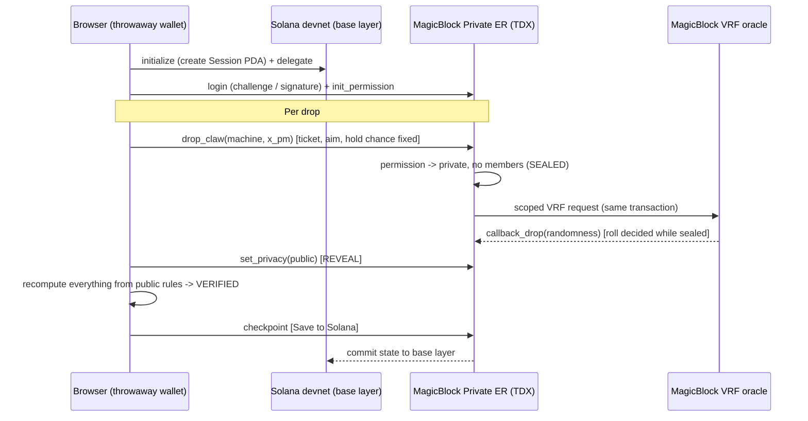

# Pinch's Arcade

**A claw-machine arcade on Solana where the roll is sealed before the drop and every receipt re-verifies in your browser.**

> The house always wins. Until Pinch shows you the receipts.

Built solo for **MagicBlock Solana Blitz v10** (Entertainment Finance). Live demo: <https://pinchs-arcade.vercel.app> (Solana **devnet**, test funds only).

Uncle Crimp's arcade sign said "WIN EVERY TIME". His claws never held. Pinch inherited the arcade and plays by one rule: show everything.

---

## The problem

In a typical arcade, app or online game, the random roll happens somewhere you cannot see, the odds are a claim rather than a number, and you get a result but no receipt. You trust the house.

## What this does differently

| Hidden in a normal game | In Pinch's Arcade |
|---|---|
| The odds | Public integer rules. Hold chance is computed on chain from where the claw lands and fixed **before** the roll. |
| The roll | Drawn by MagicBlock VRF **inside a sealed private rollup account**. Not readable by any wallet until the seal opens. |
| The receipt | Written on chain. Your browser recomputes the pit, the target, the chance and the verdict from public data and stamps `VERIFIED` or `MISMATCH`. |
| The history | "Save to Solana" commits your account to the base layer. `verify.html` re-checks any player's receipts from devnet. |

## Architecture



### On-chain program (`program/`)

Anchor 1.0.2, `ephemeral-rollups-sdk =0.16.2` (features `anchor`, `access-control`, `vrf`).
Program ID (devnet): `D9dhoGvqXAngiJBsEzZiyuY3mv43VdU39WTBszuzgZnz`.

| Instruction | Layer | What it does |
|---|---|---|
| `initialize` | base | Creates the player's `Session` PDA (`["claw", authority]`) and pre-funds permission rent. |
| `delegate` | base | Delegates the session to the TEE validator. |
| `init_permission` | ER | Creates the ephemeral permission for the session (idempotent). |
| `set_privacy` | ER | Seals / opens the account. `(true,false)` = sealed from every wallet, `(false,_)` = public (the reveal). |
| `drop_claw` | ER | Takes the ticket, fixes aim + hold chance, **seals**, and requests the **scoped VRF** roll, in one transaction. |
| `callback_drop` | ER | VRF callback only. Computes the roll and verdict from public rules and pays out. Ignores stale callbacks. |
| `cancel_pending` | ER | If the oracle never answers (requests can be purged ~2 min), the ticket is refunded. Nothing is lost to a missing callback. |
| `refill` | ER | Test-pearl faucet, only when pearls < 5. Counted on the account, never hidden. |
| `checkpoint` | ER | Commits state to Solana without leaving the rollup. |
| `undelegate`, `close_permission` | ER | Hand the account back / close the permission. |

`Session` account (Borsh, 461 bytes after the 8-byte Anchor discriminator): authority, pearls, round, drops, wins, paid, won, refills, status, pending timestamp, a ring of the last 8 receipts (round, machine, aim, slot, kind, centering, chance, outcome, roll, 32-byte VRF output), and an inventory of five prize counters.

### The public rules (`program/programs/pinch_spike/src/game.rs`, mirrored in `web/js/rules.js`)

Everything is integer maths, so Rust (on chain) and JavaScript (in your browser) agree exactly.

- 8 slots at `x = 90 + 117·i` (permille of the cabinet). The claw reaches `span/2 + 40`; the nearest slot inside reach is the target, `centering = 1000 − distance·1000/reach`.
- The pit is public: `seed = splitmix64(first 8 bytes of player key ^ round·0x9E3779B97F4A7C15 ^ machine<<56)`, slot kinds from `splitmix64(seed+i+1) % 1000` over the machine's prize mix (plus one guaranteed rare prize on Reef Run and The Abyss).
- `chance = clamp((floor + (1 − floor)·(centering)^1.3) · grip(prize), 2%, 97%)`. The `^1.3` is a 21-entry lookup table with linear interpolation, so no floats.
- `roll = u32_le(vrf_output[0..4]) % 10000 + 1`. The claw **holds iff `roll ≤ chance`**.

| Machine | Ticket | Grip floor | Claw width | Prizes (value in pearls) |
|---|---|---|---|---|
| Shell Shop | 5 | 48% | 23.7% | pearl 2, scallop 4, starfish 10 |
| Reef Run | 10 | 30% | 18.8% | + lantern fish 26 (always one in the pit) |
| The Abyss | 25 | 16% | 14.4% | scallop … golden pearl 80 (always one in the pit) |

Prize grip multipliers: pearl 1.00, scallop 0.97, starfish 0.85, lantern fish 0.62, golden pearl 0.42.

### Web client (`web/`)

Static site, no framework, no build step. `js/chain.js` talks to devnet and the private rollup (web3.js 1.98.0 + tweetnacl from a CDN); `js/rules.js` is the verifier; `js/street.js` is the pixel street, missions and race board; `js/app.js` is the cabinet and receipt UI. `api/fund.js` is a Vercel function that tops new throwaway wallets up with a few cents of devnet SOL.

## What is real, what is not

**Real and exercised on devnet**
- Program deployed to devnet; end-to-end test (`program/tests/claw.ts`) passes: three sealed drops, each receipt matches the independent JS recomputation, commit + base-layer read verified (pearls 100 → 105 → 80 → 96 in the recorded run).
- The browser client runs against the live deployment: throwaway wallet, account creation, delegation, TEE login, sealed drop, reveal, receipt `VERIFIED`.
- Rust and JS rules agree on **400 / 400** generated test vectors (`node program/tests/xcheck.js`).

**Measured latency** (devnet, from Nigeria, program test): `drop_claw` (seal + VRF request) median ~1.2 s, reveal median ~2.5 s. The game is **turn-based by design**: every step is a real confirmed transaction. It is not real-time and does not claim to be.

**Simulated, and labelled as such**
- The economy figures come from my own Monte Carlo simulation (`economics_report` test in `game.rs`), not from live play: a blind player pays back roughly 63% / 55% / 44% on the three machines, a skilled player can exceed 100%. Held does not mean profit: a pearl pays 2 on a 5-pearl ticket.
- `web/test/run.py` drives the UI against a **mock chain** that uses the real rules. It exists only to test the UI and is never shipped in the game.

## Trust model and limitations

- **The seal is a hardware assumption.** The private rollup runs in an Intel TDX enclave operated by MagicBlock. Hiding the roll from every wallet depends on that. This is **not trustless**, and the app says so. What you can always check yourself is every number on the receipt.
- **Throwaway wallets.** Anyone can create many, so the Golden Pearl Race proves fair rolls, not unique people. The race is read from the base layer and only moves when a player presses Save to Solana (rare holds auto-save).
- **Public devnet RPC rate limits.** The free endpoint returns 429 under load, which shows up as retry messages or an empty race board. Put a dedicated devnet RPC in `web/config.js` to avoid it.
- **Devnet only.** Pearls are a game score with no monetary value. There is no selling or cash-out, deliberately: it would be a fake integration.
- **VRF callback can lag.** After ~2 minutes the client calls `cancel_pending` and the ticket is refunded.

## Run it yourself

Requirements: Node 20+, Solana CLI, a devnet wallet with a few SOL.

```bash
# 1. verify the rules agree (Rust vs JS vectors)
cd program/tests && node xcheck.js            # 400 vectors, 0 mismatches

# 2. run the site locally (any static server)
cd web && npx serve .                          # faucet function needs Vercel; without it the UI asks for devnet SOL

# 3. deploy (Vercel)
cd web && npm install
cat ~/faucet.json | npx vercel env add FAUCET_SECRET production   # a funded DEVNET keypair, never commit it
npx vercel --prod
```

Optional: `web/config.js` takes a dedicated devnet RPC, for example `window.PINCH_CFG = { baseRpc: 'https://devnet.helius-rpc.com/?api-key=<key>' };`.

### Build and deploy the program

The program source is in `program/programs/pinch_spike` and the end-to-end test in `program/tests`. It was built inside an Anchor workspace created with `anchor init` (anchor-cli 1.0.2, solana-cli 3.1.10); copy `programs/` and `tests/` into that workspace, then:

```bash
anchor build --ignore-keys
solana program deploy target/deploy/pinch_spike.so --program-id target/deploy/pinch_spike-keypair.json \
  --url devnet --max-sign-attempts 50 --with-compute-unit-price 10000
```

Notes learned the hard way: the VRF scoped request (`create_request_scoped_randomness_ix`) exists in `ephemeral-rollups-sdk` **0.16.2** but not 0.18, so the version is pinned. If the `.so` grows, run `solana program extend <id> <bytes>` before upgrading. The public devnet RPC rate limits deploys, hence the retry flags.

### Demo video

`video/` is a small deterministic scene renderer (headless Chromium frames + ffmpeg) with a narration script in `video/script.md`. `python3 video/render.py` renders the animated scenes; voice-over files go in `video/audio/`.

## Repository layout

```
program/   Anchor program (lib.rs, game.rs), end-to-end test, rule-vector cross-check
web/       static site: game, street, missions, race board, receipt verifier, faucet function
web/test/  headless UI test against a mock chain (testing only)
video/     demo-video scene renderer and narration script
```

## MagicBlock tech used

- **Ephemeral Rollups**: delegation, commit/checkpoint, undelegation.
- **Private Ephemeral Rollup (TDX)** with the **Permission Program**: the sealed account.
- **VRF**: scoped randomness requested and consumed inside the rollup.

## Author

Benjamin Hunpe, solo build, Nigeria.
